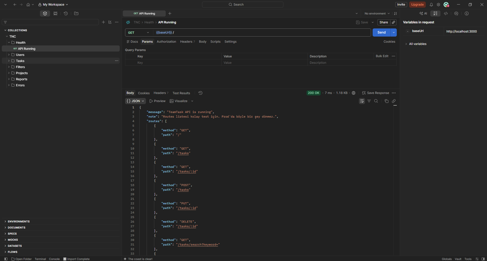
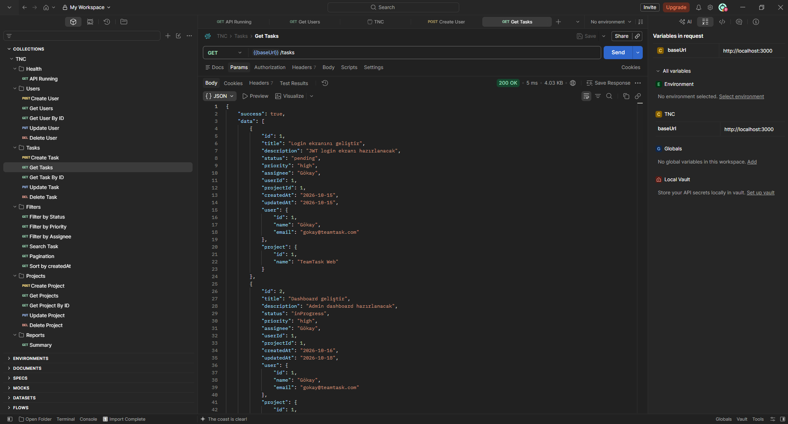
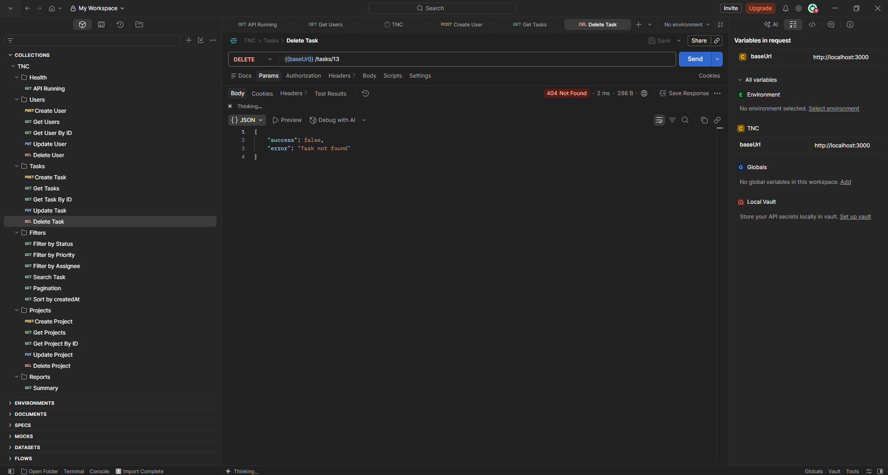
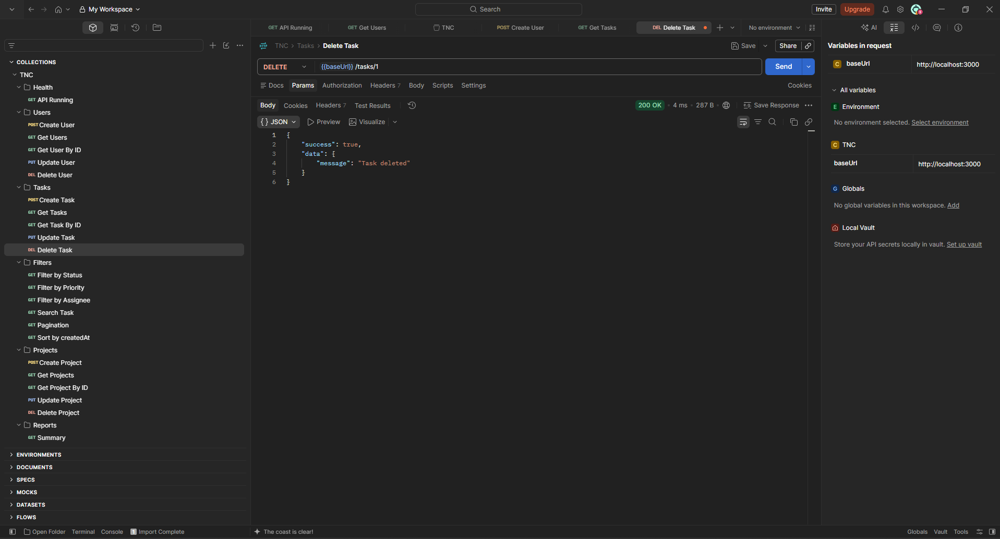
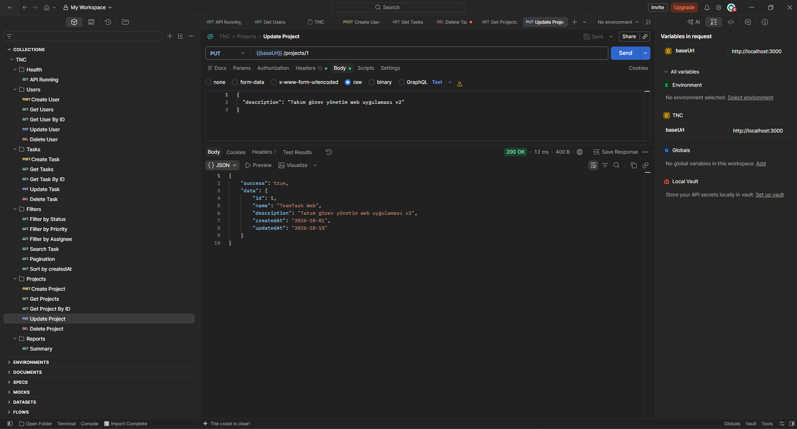
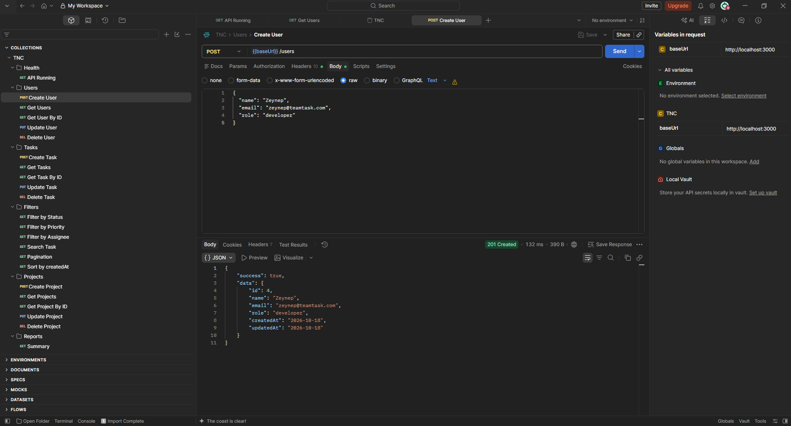
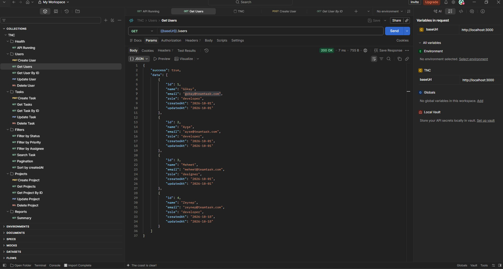

# Kullanım

İlk ayağa kaldırma ve takılınca bakacağım yer.

## Çalıştır

```bash
cd backend
npm install
npm start
```

```text
Server running on http://localhost:3000
```

Port 3000 doluysa eski node kalmıştır, onu kapatıyorum. Windows'ta önceki `npm start` bazen arkada duruyor.

## Ayakta mı

Tarayıcı yeter:

```text
http://localhost:3000/
```

```json
{
  "message": "TeamTask API is running",
  "note": "Routes listesi kolay test için. Prod'da böyle bir şey dönmez.",
  "routes": []
}
```

Alttaki `routes` tarayıcıdan endpoint bakayım diye. Prod'da koymazdım.

Postman'de health böyle duruyor:



Gerisi Postman. Collection:

```text
postman/TeamTask_API.postman_collection.json
```

## Liste

```text
GET http://localhost:3000/tasks
```

Cevap böyle:

```json
{
  "success": true,
  "data": []
}
```

`data` array. Görevin yanında user ve project özeti de var.



## Görev aç

```text
POST http://localhost:3000/tasks
Content-Type: application/json
```

```json
{
  "title": "Dashboard geliştir",
  "description": "Admin dashboard hazırlanacak",
  "priority": "high",
  "assignee": "Gökay",
  "projectId": 1
}
```

priority sadece:

```text
low
medium
high
```

assignee `GET /users`'taki bir isim. projectId `GET /projects`'teki bir id. Uydurma basarsam 400, sessiz kaydetmiyorum.

## Güncelle / sil

```text
PUT    http://localhost:3000/tasks/2
DELETE http://localhost:3000/tasks/2
```

Kayıt yoksa 404. Collection'daki Delete varsayılan id 13, bende o yoktu:



Olunca 200:



PUT'ta hepsini göndermiyorum, değişeni yeter:

```json
{
  "status": "completed"
}
```

status:

```text
pending
inProgress
completed
```

Proje güncelleme:



Kullanıcı:





## Aklımda tuttuğum şeyler

Create'den gelen `id`'yi tutuyorum, sonraki put/delete onda.

Filtre query string, body değil.

Sayfalama istiyorsam `page` ve `limit`. O zaman `pagination` da geliyor.

400 olursa `error` string'ine bakıyorum.

404 ya kayıt yok ya url yanlış. Önce route.

## Takılınca

```text
sunucu açılmıyor              port 3000 dolu
Task title is required        body boş / title yok / content-type unuttum
Task priority is invalid      High veya urgent yazmışımdır, high olacak
User not found                assignee listede yok
Project not found             projectId yanlış
User has assigned tasks       önce görevleri temizle
Project has related tasks     aynı, proje için
```

## Datayı sıfırla

```text
src/data/tasks.json
src/data/projects.json
src/data/users.json
```

Test ederken şişerse git checkout.
