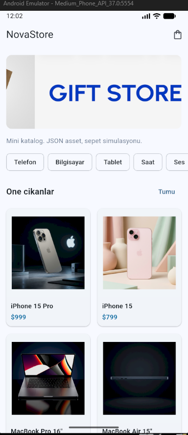
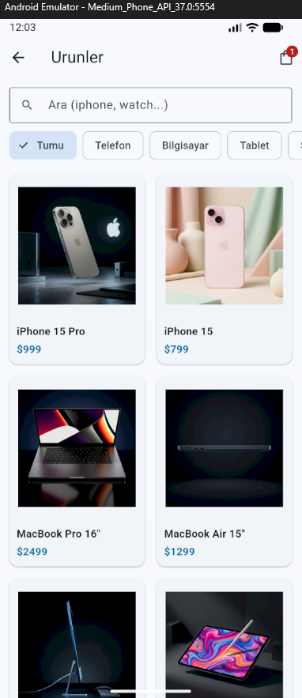
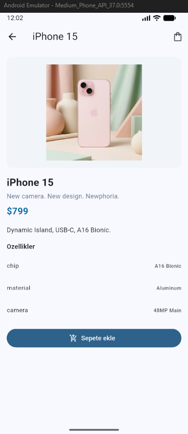
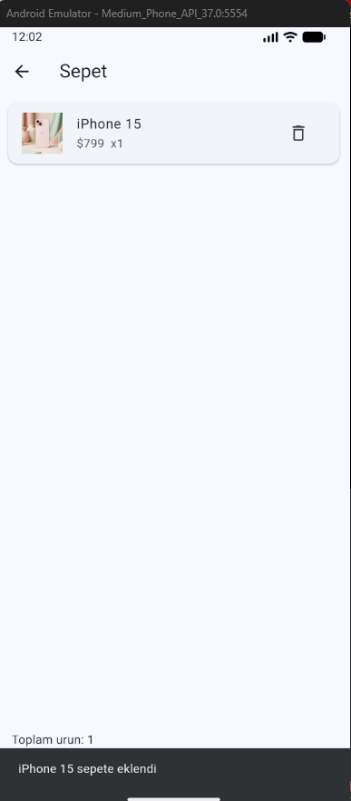

# NovaStore Mini Katalog

Flutter ile katalog uygulaması. SQL'deki NovaStore senaryosunun telefon hali.

Ürün listesi, detay, sepet simülasyonu. Ekstra paket yok, sadece Material. Ürünler `assets/data/products.json`, görseller `assets/images`. Canlı API yok.

Kod:

```text
mobil_uygulama/nova_store
```

## Nasıl çalıştırılır

Flutter SDK ve emülatör (veya USB telefon).

```bash
cd mobil_uygulama/nova_store
flutter create . --project-name nova_store --platforms android,ios
flutter pub get
flutter run
```

`flutter create .` android/ios üretir. `lib` durur.

```bash
flutter doctor
```

## Ne var

```text
Ana sayfa     banner, kategori, öne çıkan ürünler
Katalog       GridView, arama, kategori filtresi
Detay         görsel, fiyat, sepete ekle
Sepet         adet, sil, sipariş butonu (gerçek ödeme yok)
```









Named route. Detaya ürün argument gidiyor.

```text
/           HomePage
/products   ProductListPage
/detail     ProductDetailPage
/cart       CartPage
```

Sepet `setState` + `CartScope`.

## Docs

- [Proje tanıtımı](docs/PROJE_TANITIM.md)
- [Kullanım](docs/KULLANIM_KILAVUZU.md)
- [Uygulama README](nova_store/README.md)
