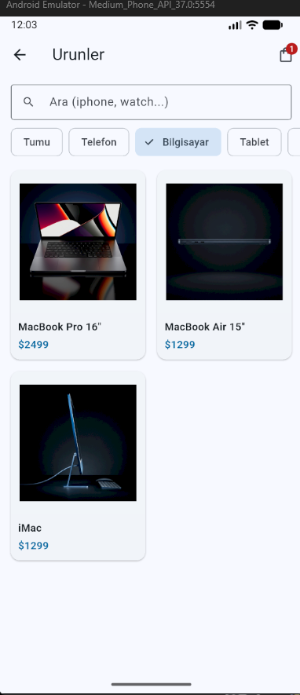
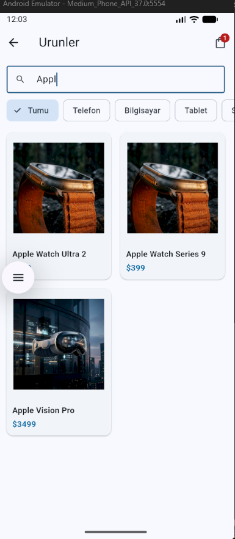

# NovaStore mini katalog ne iş

Yönerge: Flutter ile Mini Katalog. Widget, sayfa geçişi, model, klasör.

İsim NovaStore. SQL ödevindeki mağaza, burada telefon uygulaması.

## Neden asset, neden api paketi yok

Yönerge ekstra paket yasak. `http` de paket. O yüzden ürünleri `products.json` yaptım, uygulama açılınca `rootBundle` ile okuyor.

Kaynak yine eğitim apisi:

```text
https://wantapi.com/products.php
https://wantapi.com/assets/banner.png
```

Gerçek mağaza değil, yönerge de öyle diyor. fromJson / toJson modelde var.

## Ekranlar

```text
HomePage            banner, kategori chip, one cikan grid
ProductListPage     arama + filtre + GridView
ProductDetailPage   gorsel, aciklama, specs, sepete ekle
CartPage            liste, sil, siparis butonu (snackbar)
```

Emülatörden örnekler `docs/docs_assets`:


Katalogda Bilgisayar chip'i:



Arama `Appl`:



Sepet gerçek ödeme değil. StatefulWidget + InheritedWidget (`CartScope`). setState ile adet artıyor.

## Navigasyon

Named route + argument:

```text
Navigator.pushNamed(context, '/products', arguments: 'Telefon');
Navigator.pushNamed(context, '/detail', arguments: product);
```

Geri `pop`. MaterialPageRoute `onGenerateRoute` içinde.

## Widget'lar

```text
Stateless   ProductCard, ProductDetailPage, CartPage
Stateful    HomePage, ProductListPage, NovaStoreApp
```

Card, ListTile, GridView, ListView.builder, Image.asset, TextField, FilterChip, SnackBar. Hepsi material.

## Klasör

```text
lib/models      Product, CartItem
lib/data        json okuma
lib/cart        CartScope
lib/screens     4 sayfa
lib/widgets     kart
assets/images   banner + urun
assets/data     products.json
```
