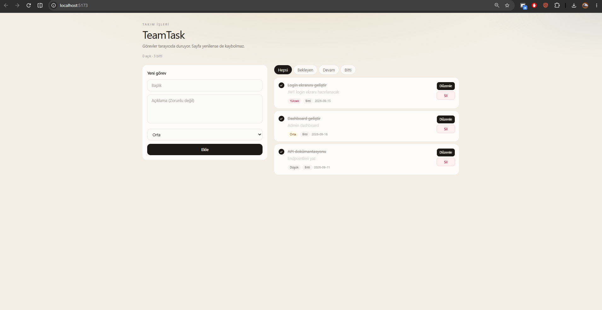
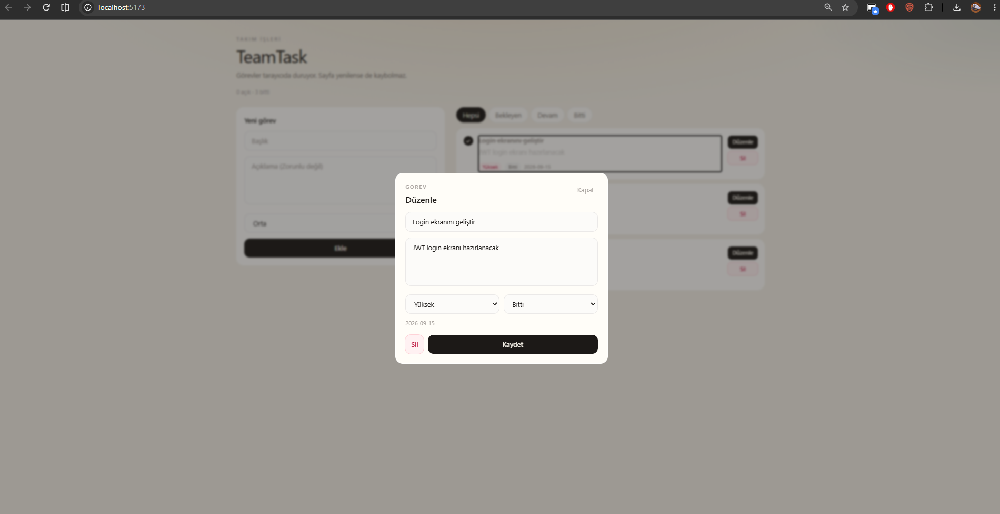
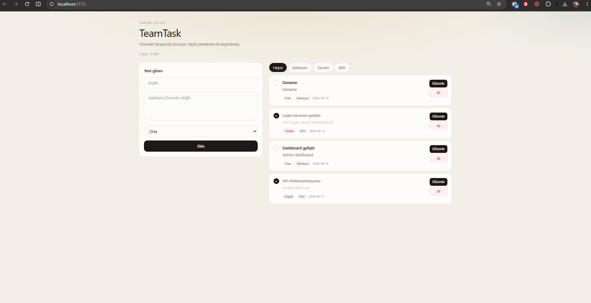

# TeamTask Web

backend'deki görev işinin tarayıcı hali. React + Vite + Tailwind.

backend'e bağlı değil. Görevler `localStorage`'da. Sayfa yenilense de duruyor.

## Nasıl çalıştırılır

```bash
cd web_geliştirme
npm install
npm run dev
```

```text
http://localhost:5173
```

Sol form, sağ liste:



Build:

```bash
npm run build
```

Çıktı `dist`. Netlify yayın klasörü de o. `netlify.toml` duruyor.

## Ne var

```text
Ekle        üstteki form
Listele     alttaki kartlar
Güncelle    Düzenle açılınca modal, Kaydet
Sil         Sil
```

Düzenle modalı:



Liste:



```text
src/components
src/pages
src/interfaces
src/utils
```

## Docs

- [Proje tanıtımı](docs/PROJE_TANITIM.md)
- [Kullanım](docs/KULLANIM_KILAVUZU.md)
